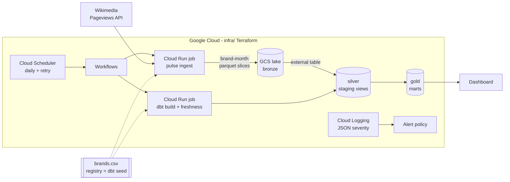

# Brand Pulse

Share-of-attention analytics for competing brands. Daily Wikipedia pageviews for a
registry of brands land in a parquet lake, dbt builds a medallion model on top, and a
dashboard shows which brand owns the category's attention and which days it spiked.

The same code runs in two modes:

| | Local / CI | Google Cloud |
|---|---|---|
| Lake (bronze) | `data/lake/` | GCS bucket, read by a BigQuery external table |
| Warehouse | DuckDB | BigQuery (`silver`, `gold`, `config` datasets) |
| Orchestration | `make pipeline` | Cloud Scheduler -> Workflows -> Cloud Run jobs |
| Alerting | exit codes | log-based alert policy -> email |

## Architecture



**Gold marts**

- `fct_brand_daily` - views per brand and day; incremental with a restatement lookback.
- `fct_share_of_attention` - a brand's share of its category's daily views (the
  pageview analogue of share of voice), 7-day smoothing, week-over-week change.
- `fct_buzz_events` - days far above the brand's own baseline: a z-score against the
  previous 28 days, the day itself excluded so a spike cannot inflate its own baseline.

## Design decisions

**The unit of work is a brand-month slice.** One API call returns a brand's whole
range; rows are split by month and each month's parquet file is replaced as a whole.
A rerun produces the same files (idempotent), late restatements inside the window are
absorbed, and the lake holds one file per brand per month instead of thousands of daily
fragments. Locally a slice is written next to the live file and renamed over it; on GCS
the object is published atomically when its upload completes.

**A failed brand is skipped, never cleared.** Its previous files stay, the run goes on,
and one ERROR names every skipped brand with its cause (`puma: 429`). The retry schedule
reruns the same idempotent window and fills it in. Only a run where every brand failed
is an error - and then the lake is not touched.

**Respect the source, handle its quirks at the edge.**
- The API answers anonymous bursts with 429 after ~10 calls, so a shared rate limiter
  paces all worker threads; `Retry-After` is honoured, 404 is never retried.
- The API leaves out days with zero views. Ingestion writes them as 0, so downstream a
  missing row always means a missing load - which a dbt test then catches.
- The API counts exact titles and does not follow redirects: after a rename the old
  title keeps the history. A brand is therefore a current title plus former titles,
  summed; `pulse check-registry` fails if a current title is a redirect or a former one
  does not redirect to it. (Found in the data: three renamed brands showed a fraction
  of their real traffic.)

**Configuration is data.** The brand registry is the dbt seed, and ingestion reads the
same file - adding a brand is one CSV row, no code change, no redeploy.

**Every layer is tested where its bugs live.**
- `pytest` (hermetic, no network): retries and backoff, rate limiting, idempotent
  reruns, skip-not-clear, renamed articles, zero days.
- dbt data tests: one row per brand-day, no missing days (the 7-day windows count rows),
  shares sum to 1 per category-day, referential integrity to the registry.
- dbt unit test for the anomaly logic, source freshness on `_loaded_at`.
- CI runs the whole dbt build on a synthetic lake written by the real ingestion code,
  plus `terraform fmt` / `validate`.

**Operable in production.** JSON logs carry `severity`, so Cloud Logging and the alert
policy see real ERRORs; one alert policy covers skipped brands, crashed jobs, failed
freshness and failed workflow executions. Service accounts are least-privilege; the
lake bucket is versioned, so a bad load can be rolled back per file.

## Run it locally

```bash
make setup                                        # venv with ingestion, dbt-duckdb, dashboard
make backfill START=2025-11-01 END=2026-11-09     # ~2 min: 18 rate-limited API calls
make dashboard                                    # http://localhost:8501
```

Daily: `make pipeline` (ingest the lookback window, `dbt build`, source freshness).
Offline: `make sample` writes a synthetic lake, then `make transform`.
Lineage graph: `make docs`.

## Deploy to Google Cloud

```bash
cd infra
terraform init -backend-config="bucket=<state-bucket>"
terraform apply -var project_id=<project> -var alert_email=<email>
gcloud builds submit .. --tag "$(terraform output -raw image)"
```

The infrastructure is validated (`terraform validate`) but has not been applied: it
needs a GCP project with billing.

## Repository layout

```
src/pulse/          ingestion: API client, rate limiter, lake writer, run, CLI
transform/          dbt project: seeds (registry), staging (silver), marts (gold), tests
infra/              Terraform: bucket, datasets, external table, jobs, workflow, scheduler, IAM, alerting
orchestration/      Cloud Workflows definition
dashboard/          Streamlit app over the gold layer
tests/              pytest suite + synthetic lake generator for CI
```

## Next steps

- Robust anomaly score (median and MAD) so one past spike does not mute the next.
- Slack or Telegram digest of new buzz events.
- More wikis per brand (`de`, `uk`, ...) - the registry already carries `wiki_project`.
